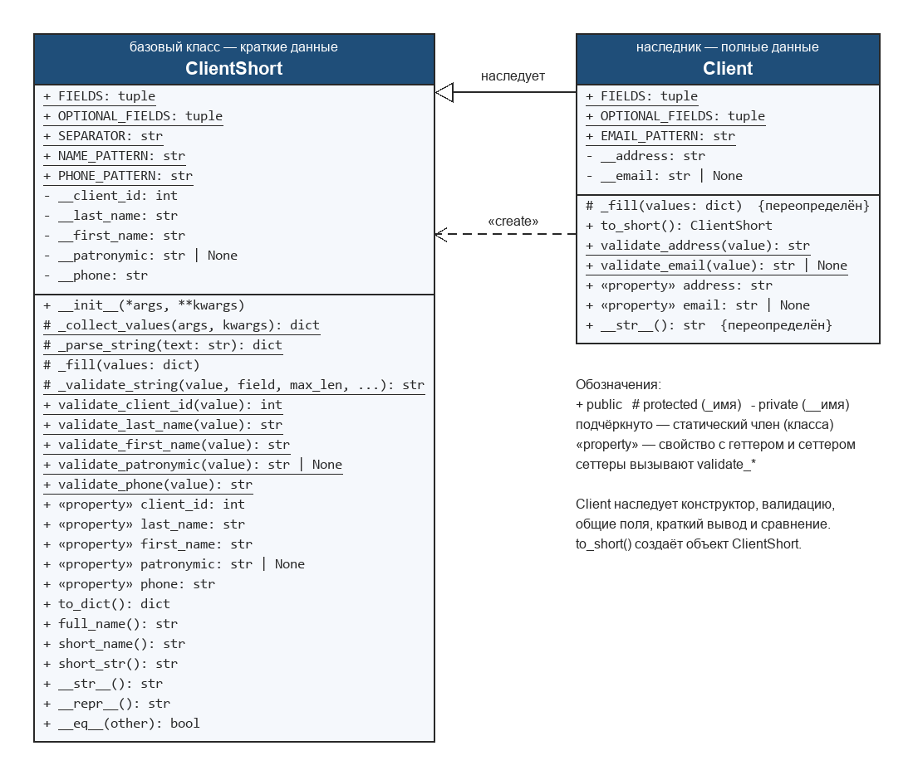
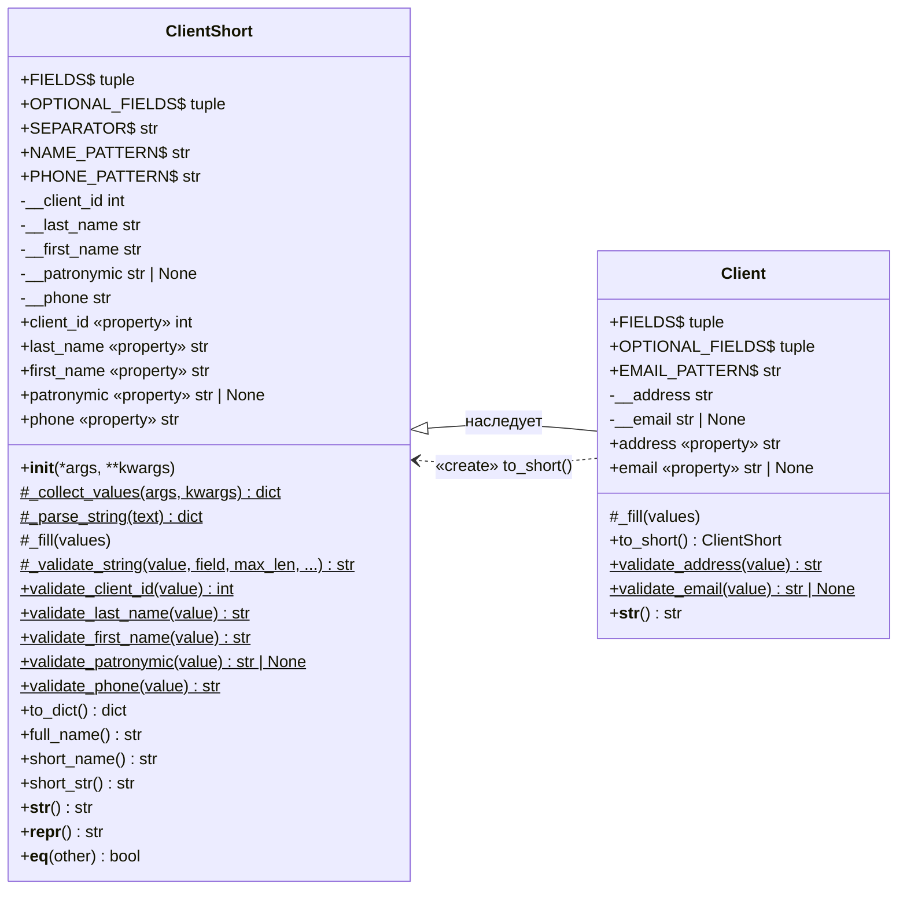

# Диаграмма классов

PNG рисует скрипт `python tools/draw_diagrams.py`. Ниже та же диаграмма в формате
Mermaid (её показывает GitHub).

Обозначения: `+` public, `#` protected (`_имя`), `-` private (`__имя`),
`$` — статический член класса.

