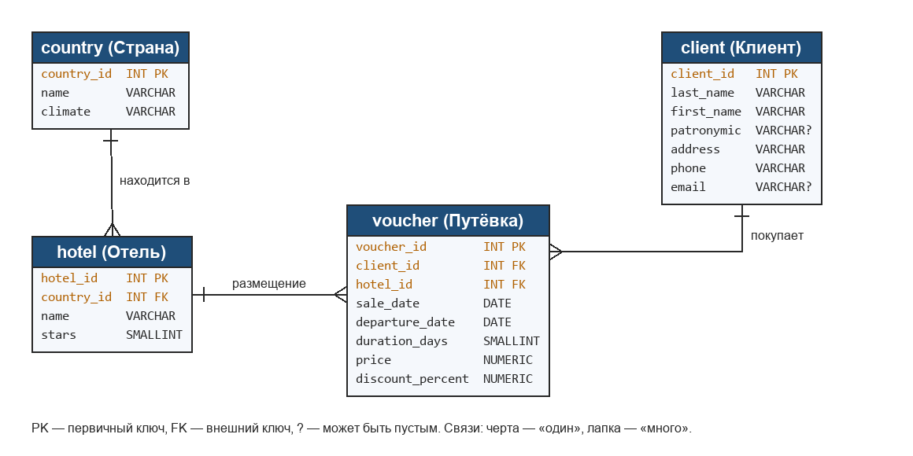
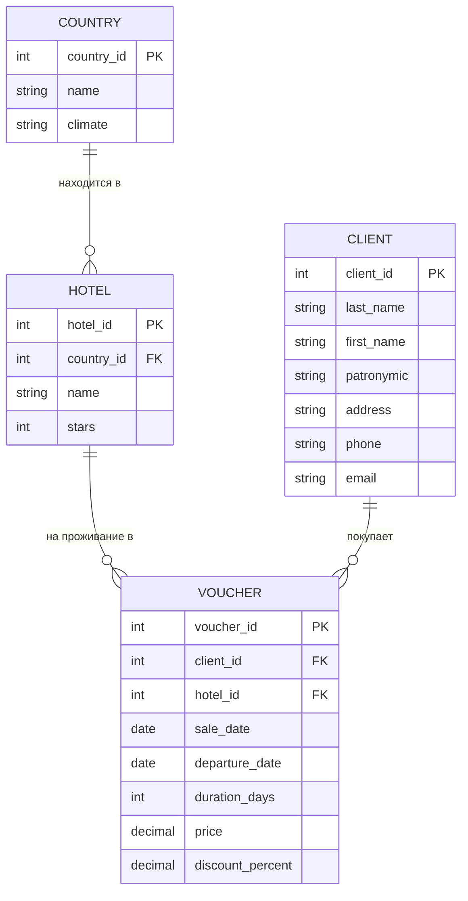

# ER-модель: «Туристическая фирма»

Туристическая фирма продаёт клиентам путёвки. У клиента собираются стандартные данные:
ФИО, адрес и телефон. Клиенту подбирают вариант отдыха: страну (с особенностями климата)
и отель определённого класса. При продаже путёвки фиксируются дата отправления,
длительность, стоимость и скидка. Клиент может купить несколько путёвок.

## Таблицы

| Таблица | Назначение | Связи |
|---|---|---|
| `country` (Страна) | название и особенности климата | 1 : N с `hotel` |
| `hotel` (Отель) | название и класс (1–5 звёзд) | N : 1 с `country`, 1 : N с `voucher` |
| `client` (Клиент) | ФИО, адрес, телефон, e-mail | 1 : N с `voucher` |
| `voucher` (Путёвка) | факт продажи: даты, длительность, цена, скидка | N : 1 с `client` и `hotel` |

Полная схема со всеми ограничениями лежит в [schema.sql](schema.sql).

## Почему это 3НФ

* **1НФ.** Все атрибуты атомарны: ФИО разбито на фамилию, имя и отчество, повторяющихся
  групп нет (несколько путёвок клиента — это несколько строк `voucher`, а не список в `client`).
* **2НФ.** Во всех таблицах первичный ключ простой (суррогатный `*_id`), поэтому частичных
  зависимостей от части ключа быть не может.
* **3НФ.** Нет транзитивных зависимостей:
  * климат зависит от страны, а не от отеля, поэтому вынесен в `country`;
  * класс отеля зависит от отеля, а не от путёвки, поэтому хранится в `hotel`;
  * в `voucher` хранятся только ссылки на клиента и отель, а не их данные.

## Основная сущность для ЛР1–ЛР4: `client` (Клиент)

Независимые сущности (без внешних ключей) в модели: `country` и `client`.
`hotel` и `voucher` зависят от других таблиц, поэтому не подходят.

| Независимая сущность | Полей |
|---|---|
| `country` | 3 |
| **`client`** | **7** |

У клиента больше всего полей: `client_id`, `last_name`, `first_name`, `patronymic`,
`address`, `phone`, `email`. Дальше в ЛР1–ЛР4 работаем только с ним.
